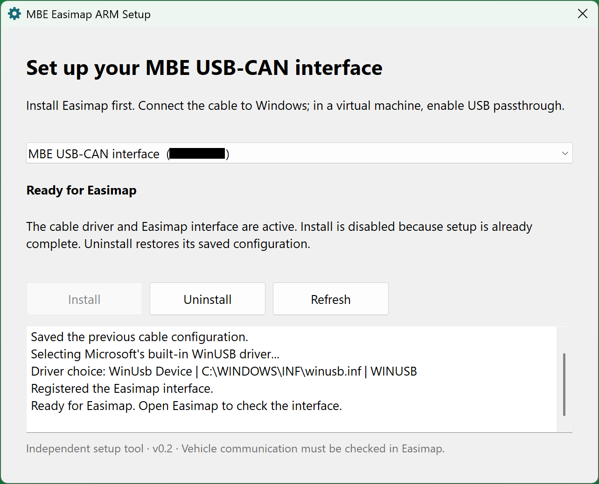
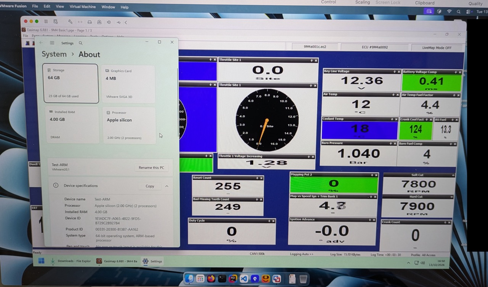

# MBE Easimap ARM Setup

A small native Windows 11 ARM64 utility for configuring an MBE 985 USB-CAN cable
with Easimap. It uses Windows' built-in WinUSB driver and the original MCL
interface registration.

This is an independent community utility, not a product supplied or endorsed by
MBE or SBD Motorsport. Driver setup and Easimap-to-vehicle communication have
been tested on a Mac Mini using Windows 11 ARM in VMware Fusion. This is one
confirmed configuration; other hardware still needs validation but it should
work with any Apple Silicon device running Windows 11 ARM in a virtual machine
using USB passthrough for the cable, or a Snapdragon or similar ARM system
running Windows 11 ARM directly.

## Using the utility

Install Easimap separately, connect the cable to Windows (including VM USB
passthrough if necessary), open `MBE-Easimap-ARM-Setup.exe` and approve the
administrator prompt (necessary to install the driver and registration). Install
is available only when a supported connected cable needs setup. An already-ready
cable disables Install; no cable disables both action buttons.

Uninstall restores the configuration saved before setup. A cable configured
manually without a backup has only its MCL registration removed, keeping its
existing driver. Logs and recovery backups are under
`C:\ProgramData\MBE-Easimap-ARM-Setup`. See [README.txt](README.txt) for
details.

Only the MBE 985 USB-CAN interface with hardware ID `USB\VID_FEFE&PID_0001` is
supported. The utility does not modify ECU settings, ship vendor software,
install a custom USB driver or alter Windows signing policy.

## Open in Visual Studio 2026

1. Install **Desktop development with C++**, the **ARM64 MSVC build tools**, and
   **Windows 11 SDK 26100 or newer**. `.vsconfig` records the required
   components and can be imported into the Visual Studio Installer.
2. Open **MBE-Easimap-ARM-Setup.sln**.
3. Select **Debug | ARM64** and make **MBE.Easimap.Setup** the startup project
   (right-click the project and choose *Set as Startup Project* if necessary).
4. Build the solution. Set a breakpoint in `mbe::install`, `mbe::uninstall` or
   `Window::operation`, then press **F5** on a Windows ARM64 machine.

The setup executable requests elevation. For an F5 session that changes device
settings, start Visual Studio **as administrator** and close any existing setup
window. The app's global mutex prevents simultaneous setup instances. No
connected cable is needed to explore the UI or run the backup-format tests.

An Intel/x64 Windows machine can build ARM64 executables, but these executables
must be run/debugged on Windows ARM64. No x64 target is provided.

The project selects the VS 2026 `v145` toolset. VS 2022 is supported using
`v143`. Both use C++20 and statically link the C/C++ runtime. No NuGet or other
third-party dependency restore is required for the native solution.

## Solution projects

| Project | Purpose |
| --- | --- |
| MBE.Easimap.Setup | Native window, command-line diagnostics, icon and manifest. |
| MBE.Easimap.Setup.Core | Static library containing device APIs, backups and reversible setup. Linked into the app; no extra DLL is distributed. |
| BackupTests | Safe backup-format checks, with no device or administrator requirement. Built by default. |
| LiveDeviceTests | Explicit development cable cycle. Excluded from the default solution build and never run automatically. |

Outputs are isolated under `artifacts/bin/ARM64/Debug/` and
`artifacts/bin/ARM64/Release/`; intermediate files are under `artifacts/obj/`.
Debug has optimisations disabled and compiler/linker symbols. Release is
optimised and also produces PDB files for diagnostics. Building never replaces
an installed utility or changes a connected cable.

From a Visual Studio Developer Command Prompt, `build.cmd Debug` or `build.cmd
Release` builds the same solution. Run `BackupTests.exe` from the matching
output folder, or make BackupTests the startup project and press F5.

## Finding your way around

- `src/app/main.cpp`: window, DPI layout, user actions and worker-thread
  progress.
- `src/app/resources/`: icon, version information and administrator/DPI
  manifest.
- `src/core/setup.h`: the shared API, with XML-style documentation comments.
- `src/core/device.cpp`: Windows device/driver and registry APIs.
- `src/core/setup.cpp`: backup serialization and install/uninstall workflow.
- `src/core/resources/strings.rc`: window text, prompts, progress, errors and
  diagnostic captions.
- `src/core/strings.h` / `strings.cpp`: resource loading and numbered message
  inserts.
- `tests/`: separate safe backup test and opt-in live device test entry points.
- `build/Native.props`: settings shared by all projects, including `/MT` and
  `/MTd`.

Comments use Visual Studio's `/// 
`, `<remarks>`, `<param>` and
`<returns>` format for IntelliSense. Implementation comments explain ownership,
thread boundaries, preservation of the baseline, and Windows driver quirks
rather than restate every line. The source uses `.clang-format` for consistent
four-space indentation, indented namespace contents, braces on control-flow
blocks and space between definitions.

Application text is stored in native Windows `.rc` string tables. Open
`src/core/resources/strings.rc` in Visual Studio and edit its String Table, or
edit the text directly. `resource.h` defines each `IDS_` identifier. Messages
with dynamic values use zero-based inserts such as `{0}`; preserve the insert
numbers when editing, and use `{{` or `}}` for literal braces. The text is
compiled into each executable, so no separate resource file or runtime is
needed. See [architecture](docs/ARCHITECTURE.md#strings-and-resources) for the
boundary between application text and fixed Windows/backup identifiers.

Read [architecture](docs/ARCHITECTURE.md), [testing and
debugging](docs/TESTING.md), [contributing](CONTRIBUTING.md) and [sharing
status](docs/SHARING.md).

## Licence and releases

Copyright (c) 2026 Simon Hoade.

This project is licensed under the [GNU General Public License v3.0](LICENSE)
(GPL-3.0-only). Distributed modified versions must provide their corresponding
source under the same licence and retain the required notices. Commercial use is
permitted. The software is provided without warranty; see LICENSE for the
complete terms. Easimap and vendor software remain separately licensed.

Source belongs in this repository; compiled downloads belong in GitHub Releases.
See [sharing and release notes](docs/SHARING.md) for packaging guidance.
Generated binaries, IDE state, credentials, device logs and recovery backups are
excluded from source control.
